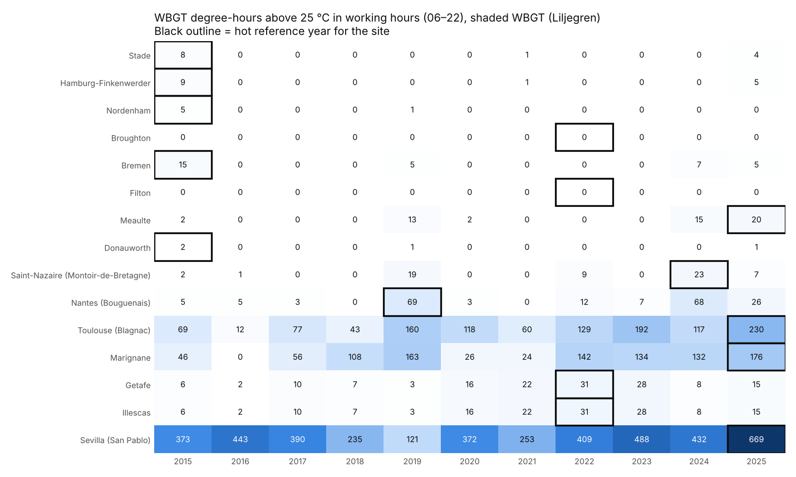
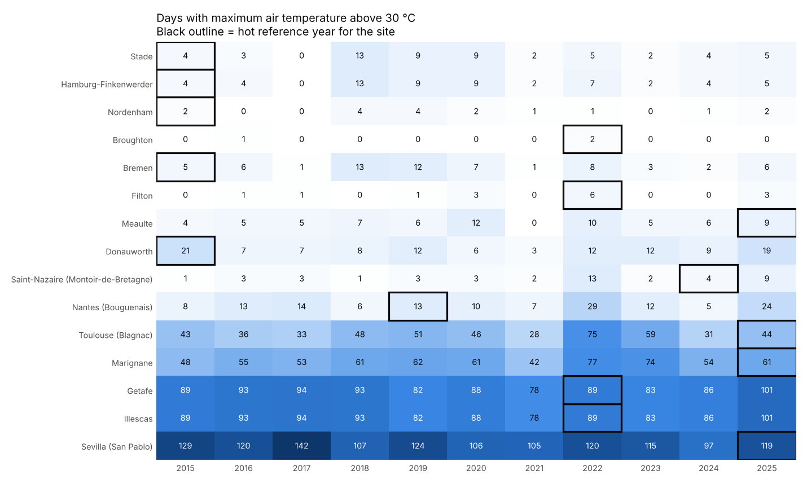
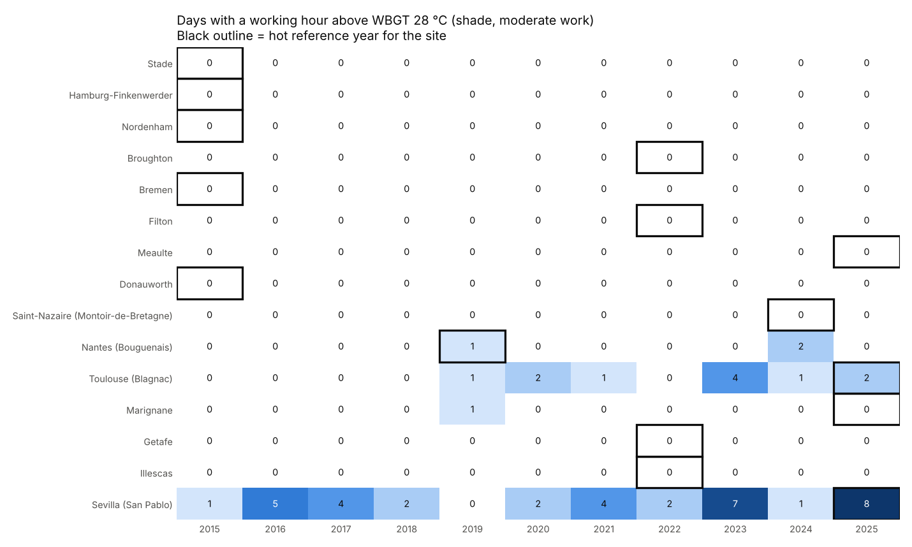
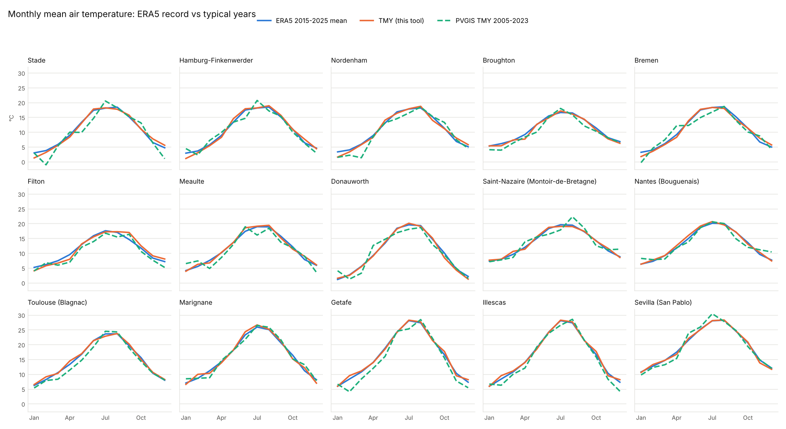

# Phase 1: Historical weather files

**Status:** complete (Nov 2026). Re-run with `scripts/fetch_era5.py` then `scripts/phase1_historical.py`.

## What was produced

| Output | Location | In git |
|---|---|---|
| ERA5 hourly record 2015–2025, standard format, per site | `data/weather/hourly/` | No (83 MB; reproducible) |
| Typical meteorological year (ISO 15927-4), per site | `data/weather/tmy/{site}_tmy.parquet` | Yes |
| Hot reference year (unadjusted), per site | `data/weather/hot_year/{site}_{year}.parquet` | Yes |
| PVGIS TMY (cross-check), per site | `data/weather/pvgis/` | Yes |
| Annual indicators per site and year | `outputs/phase1/annual_summary.csv` | Yes |
| TMY month selection (source year per month) | `outputs/phase1/tmy_month_selection.csv` | Yes |
| Hot reference years | `outputs/phase1/hot_reference_years.csv` | Yes |
| Monthly cross-check (ERA5 mean / TMY / PVGIS) | `outputs/phase1/monthly_crosscheck.csv` | Yes |
| ERA5 grid point used per site | `outputs/phase1/era5_grid_points.csv` | Yes |
| Figures | `docs/phase1/figures/` | Yes |

All 15 sites passed the automated checks: complete hourly record, no gaps or duplicates, and values in plausible ranges (`outputs/phase1/validation.json`).

## Method summary

1. **Download:** ERA5 hourly time series from Copernicus CDS (`reanalysis-era5-single-levels-timeseries`), 1 Jan 2015 – 1 Jan 2026, 12 variables, about 30–120 s per site.
2. **Standardise:**
   - Temperature and dew point are converted to °C, and RH is calculated from them (Magnus).
   - Wind speed and direction come from the u/v wind components.
   - Hourly radiation totals are converted to W/m². DNI is derived from direct horizontal radiation and the sun position at mid-hour, and DHI = GHI − direct horizontal.
   - Timestamps are UTC and mark the end of each hour.
3. **TMY (ISO 15927-4):**
   - For each month, the Finkelstein–Schafer statistic is calculated on daily mean temperature, GHI and RH, and each year is ranked on it.
   - Of the three best-ranked years, the one whose wind speed is closest to the monthly mean is chosen.
   - Joins between months are blended over ±8 h. 29 Feb is dropped, giving 8,760 hours on a nominal year (2001).
4. **Hot reference year (decision D42):** each year is ranked by **WBGT degree-hours above 25 °C in working hours** (06:00–22:00 local), using the shaded / indoor WBGT (originally a provisional psychrometric WBGT; since Phase 3 the Liljegren model with no solar radiation and 0.3 m/s indoor air speed): the sum of (WBGT − 25) over the hours above 25. Ties are broken by hours above 30 °C, then annual maximum temperature.
5. **Cross-check:** the PVGIS 5.3 TMY (ERA5 meteorology + SARAH-3 satellite radiation, 2005–2023) is compared with our TMY.

## Results per site (south → north)

| Site | ERA5 grid point (distance) | TMY mean T (°C) | TMY − ERA5 11-yr mean | TMY − PVGIS | Hot year | WBGT degree-hours > 25 (working hrs): median → hot year | Working hours WBGT > 26 (> 28): median → hot year |
|---|---|---|---|---|---|---|---|
| Sevilla (San Pablo) | 37.50, -6.00 (14 km) | 19.1 | -0.1 | +0.0 | **2025** | 447 → 737 | 197 (12) → 321 (27) |
| Illescas | 40.25, -3.75 (12 km) | 16.3 | +0.2 | +1.1 | **2022** | 17 → 47 | 2 (0) → 11 (0) |
| Getafe | 40.25, -3.75 (6 km) | 16.3 | +0.2 | +1.6 | **2022** | 17 → 47 | 2 (0) → 11 (0) |
| Marignane | 43.50, 5.25 (8 km) | 15.9 | +0.1 | -0.0 | **2025** | 116 → 196 | 51 (0) → 92 (2) |
| Toulouse (Blagnac) | 43.75, 1.25 (14 km) | 14.9 | +0.2 | +1.0 | **2025** | 123 → 250 | 59 (3) → 107 (8) |
| Nantes (Bouguenais) | 47.25, -1.50 (12 km) | 13.2 | +0.2 | +0.1 | **2019** | 6 → 72 | 0 (0) → 28 (4) |
| Saint-Nazaire (Montoir-de-Bretagne) | 47.25, -2.25 (10 km) | 13.4 | +0.1 | -0.1 | **2024** | 1 → 23 | 0 (0) → 14 (0) |
| Donauworth | 48.75, 10.75 (5 km) | 9.9 | -0.2 | +0.0 | **2015** | 0 → 4 | 0 (0) → 0 (0) |
| Meaulte | 50.00, 2.75 (6 km) | 11.6 | +0.1 | +0.6 | **2025** | 1 → 22 | 0 (0) → 9 (0) |
| Filton | 51.50, -2.50 (6 km) | 11.2 | +0.1 | +1.0 | **2022** | 0 → 0 | 0 (0) → 0 (0) |
| Bremen | 53.00, 8.75 (7 km) | 10.5 | -0.2 | +0.3 | **2015** | 0 → 15 | 0 (0) → 7 (0) |
| Broughton | 53.25, -3.00 (8 km) | 10.4 | -0.3 | +0.6 | **2022** | 0 → 0 | 0 (0) → 0 (0) |
| Nordenham | 53.50, 8.50 (2 km) | 10.4 | -0.1 | +0.7 | **2015** | 0 → 5 | 0 (0) → 2 (0) |
| Hamburg-Finkenwerder | 53.50, 9.75 (7 km) | 10.5 | +0.0 | +0.1 | **2015** | 0 → 9 | 0 (0) → 4 (0) |
| Stade | 53.50, 9.50 (8 km) | 10.4 | -0.1 | +0.7 | **2015** | 0 → 9 | 0 (0) → 5 (0) |

## Findings

1. **The TMY is representative.** At every site its annual mean temperature is within ±0.3 °C of the 2015–2025 mean, and its monthly profile follows the record closely.
2. **PVGIS agrees reasonably well.** Our TMY is 0–1.6 °C warmer. Part of this is expected, because our 2015–2025 period is more recent than PVGIS's 2005–2023. The larger gaps at the Madrid sites (+1.1 to +1.6 °C) probably also reflect PVGIS's different grid treatment. RH agrees within ±3 % points and GHI within about ±5 % at most sites.
3. **Getafe and Illescas share the same ERA5 grid point** (40.25, −3.75), so their weather files are identical. More generally, the ~25 km ERA5 grid can't separate nearby sites and smooths local peaks. **ERA5-Land** (~9 km grid, also available as a CDS time series) is an option to refine this later. It lacks the direct-radiation field, so DNI would need a separate model.
4. **Indoor WBGT above the ISO 7243 Class 2 reference is concentrated in the south.** With the hall at outdoor temperature and no solar load, the headline reference (26 °C, workforce not acclimatised, D58) is exceeded regularly only at Sevilla (median 197 working hours a year), Toulouse (59 h) and Marignane (51 h). The Madrid sites reach it on a couple of hours a year (11 h in the hot year 2022), because their heat is dry: high temperature but a low wet bulb. Northern sites exceed it only in hot years (Nantes 28 h in 2019, Saint-Nazaire 14 h in 2024, Bremen 7 h in 2015). At the acclimatised reference (28 °C) only Sevilla (12 h) and Toulouse (3 h) exceed it in a median year. Consequences:
   - The original ranking (hours > 28 °C) could not separate years at most sites, so it was replaced by **WBGT degree-hours above 25 °C** (option B, decision D42).
   - The values in this table use the Phase 3 WBGT (Liljegren). The first Phase 1 run used a provisional psychrometric WBGT, which read lower (e.g. Sevilla degree-hours 704 provisional vs 447 Liljegren indoor at 0.3 m/s, see Phase 3 for why these differ). Indoor heat gains from engineering estimates would raise all values.
5. **Hot years under option B** are the years with the most *humid* heat in working hours: 2022 for Getafe/Illescas, 2025 for Sevilla, Toulouse, Marignane and Méaulte, 2019 for Nantes, 2024 for Saint-Nazaire, and 2015 for Donauwörth and the northern German sites.
   - **UK sites (Filton, Broughton):** indoor WBGT degree-hours are zero in every year, so the ranking falls back to the tie-breakers (hours above 30 °C, then maximum temperature) and picks the record dry heat of July 2022. There is effectively no humid heat stress at these sites today. Their exposure signal will come from future warming and indoor heat gains.

## Decision: hot-year ranking metric (D42)

**Option B adopted:** WBGT degree-hours above 25 °C in working hours. Hours above the ISO 7243 reference (26 °C headline, 28 °C acclimatised) are still reported. The ranking has since been recalculated with the Phase 3 WBGT method (Liljegren); because it ranks on degree-hours above 25 °C, it does not depend on the reference value (D58 left all hot years unchanged).
