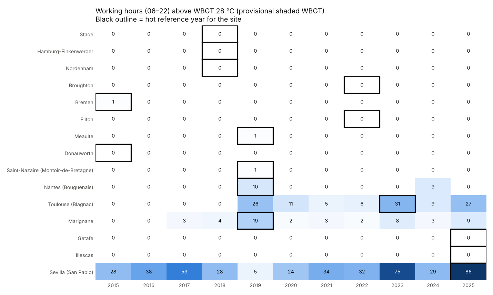

# Phase 1: Historical weather files

**Status:** complete (Nov 2026). Re-run with `scripts/fetch_era5.py` then `scripts/phase1_historical.py`.

## What was produced

| Output | Location | In git |
|---|---|---|
| ERA5 hourly record 2015–2025, standard format, per site | `data/weather/hourly/` | No (83 MB; reproducible) |
| Typical meteorological year (ISO 15927-4), per site | `data/weather/tmy/{site}_tmy.parquet` | Yes |
| Hot reference year (unadjusted), per site | `data/weather/hot_year/{site}_{year}.parquet` | Yes |
| PVGIS TMY (cross-check), per site | `data/weather/pvgis/` | Yes |
| Annual indicators per site and year | `outputs/phase1/annual_summary.csv` | Yes |
| TMY month selection (source year per month) | `outputs/phase1/tmy_month_selection.csv` | Yes |
| Hot reference years | `outputs/phase1/hot_reference_years.csv` | Yes |
| Monthly cross-check (ERA5 mean / TMY / PVGIS) | `outputs/phase1/monthly_crosscheck.csv` | Yes |
| ERA5 grid point used per site | `outputs/phase1/era5_grid_points.csv` | Yes |
| Figures | `docs/phase1/figures/` | Yes |

All 15 sites passed the automated checks: complete hourly record, no gaps or duplicates, and values in plausible ranges (`outputs/phase1/validation.json`).

## Method summary

1. **Download:** ERA5 hourly time series from Copernicus CDS (`reanalysis-era5-single-levels-timeseries`), 1 Jan 2015 – 1 Jan 2026, 12 variables, about 30–120 s per site.
2. **Standardise:**
   - Temperature and dew point are converted to °C, and RH is calculated from them (Magnus).
   - Wind speed and direction come from the u/v wind components.
   - Hourly radiation totals are converted to W/m². DNI is derived from direct horizontal radiation and the sun position at mid-hour, and DHI = GHI − direct horizontal.
   - Timestamps are UTC and mark the end of each hour.
3. **TMY (ISO 15927-4):**
   - For each month, the Finkelstein–Schafer statistic is calculated on daily mean temperature, GHI and RH, and each year is ranked on it.
   - Of the three best-ranked years, the one whose wind speed is closest to the monthly mean is chosen.
   - Joins between months are blended over ±8 h. 29 Feb is dropped, giving 8,760 hours on a nominal year (2001).
4. **Hot reference year:** each year is ranked by working hours (06:00–22:00 local) with **provisional shaded WBGT** above 28 °C. Ties are broken by hours above 30 °C, then annual maximum temperature.
5. **Cross-check:** the PVGIS 5.3 TMY (ERA5 meteorology + SARAH-3 satellite radiation, 2005–2023) is compared with our TMY.

## Results per site (south → north)

| Site | ERA5 grid point (distance) | TMY mean T (°C) | TMY − ERA5 11-yr mean | TMY − PVGIS | Hot year | Days > 30 °C: median → hot year | Working hours WBGT_prov > 28 in hot year |
|---|---|---|---|---|---|---|---|
| Sevilla (San Pablo) | 37.50, -6.00 (14 km) | 19.1 | -0.1 | +0.0 | **2025** | 119 → 119 | 86 |
| Illescas | 40.25, -3.75 (12 km) | 16.3 | +0.2 | +1.1 | **2025** | 89 → 101 | 0 |
| Getafe | 40.25, -3.75 (6 km) | 16.3 | +0.2 | +1.6 | **2025** | 89 → 101 | 0 |
| Marignane | 43.50, 5.25 (8 km) | 15.9 | +0.1 | -0.0 | **2019** | 61 → 62 | 19 |
| Toulouse (Blagnac) | 43.75, 1.25 (14 km) | 14.9 | +0.2 | +1.0 | **2023** | 44 → 59 | 31 |
| Nantes (Bouguenais) | 47.25, -1.50 (12 km) | 13.2 | +0.2 | +0.1 | **2019** | 12 → 13 | 10 |
| Saint-Nazaire (Montoir-de-Bretagne) | 47.25, -2.25 (10 km) | 13.4 | +0.1 | -0.1 | **2019** | 3 → 3 | 1 |
| Donauworth | 48.75, 10.75 (5 km) | 9.9 | -0.2 | +0.0 | **2015** | 9 → 21 | 0 |
| Meaulte | 50.00, 2.75 (6 km) | 11.6 | +0.1 | +0.6 | **2019** | 6 → 6 | 1 |
| Filton | 51.50, -2.50 (6 km) | 11.2 | +0.1 | +1.0 | **2022** | 1 → 6 | 0 |
| Bremen | 53.00, 8.75 (7 km) | 10.5 | -0.2 | +0.3 | **2015** | 6 → 5 | 1 |
| Broughton | 53.25, -3.00 (8 km) | 10.4 | -0.3 | +0.6 | **2022** | 0 → 2 | 0 |
| Nordenham | 53.50, 8.50 (2 km) | 10.4 | -0.1 | +0.7 | **2018** | 1 → 4 | 0 |
| Hamburg-Finkenwerder | 53.50, 9.75 (7 km) | 10.5 | +0.0 | +0.1 | **2018** | 4 → 13 | 0 |
| Stade | 53.50, 9.50 (8 km) | 10.4 | -0.1 | +0.7 | **2018** | 4 → 13 | 0 |

## Findings

1. **The TMY is representative.** At every site its annual mean temperature is within ±0.3 °C of the 2015–2025 mean, and its monthly profile follows the record closely.
2. **PVGIS agrees reasonably well.** Our TMY is 0–1.6 °C warmer. Part of this is expected, because our 2015–2025 period is more recent than PVGIS's 2005–2023. The larger gaps at the Madrid sites (+1.1 to +1.6 °C) probably also reflect PVGIS's different grid treatment. RH agrees within ±3 % points and GHI within about ±5 % at most sites.
3. **Getafe and Illescas share the same ERA5 grid point** (40.25, −3.75), so their weather files are identical. More generally, the ~25 km ERA5 grid can't separate nearby sites and smooths local peaks. **ERA5-Land** (~9 km grid, also available as a CDS time series) is an option to refine this later. It lacks the direct-radiation field, so DNI would need a separate model.
4. **⚠️ Shaded WBGT rarely exceeds the Class 2 reference (28 °C).** With indoor = outdoor and no solar load, only Sevilla (median 32 working hours/year), Toulouse and Marignane reach it regularly. The Madrid sites never do, because their heat is dry: high temperature but a low wet bulb. Consequences:
   - The **hot-year ranking falls back to its tie-breaker at 8 of 15 sites**. At several sites a single hour decides the year, e.g. Bremen 2015 and Méaulte 2019. Those years are not clearly the hottest on other measures; Sevilla's chosen year, for example, has a median number of days above 30 °C.
   - The provisional WBGT **underestimates** real WBGT: the psychrometric wet bulb is lower than the natural wet bulb in still air, and there is no radiant load. Phase 3 (Liljegren method, sun and shade) will raise values, and indoor offsets from engineering estimates will raise them further.
5. **Recognisable hot years:** 2018 for northern Germany, 2019 for northern and western France, 2022 for the UK, 2023 for Toulouse, and 2025 for Spain. These match the known European heatwave summers.

## Decision needed: hot-year ranking metric

Because WBGT > 28 °C hours are zero in most years at most sites, the ranking needs a metric that separates years everywhere:

| Option | Metric | Comment |
|---|---|---|
| A (current) | Working hours WBGT > 28 °C, tie-break hours > 30 °C | Keeps the agreed rule but in practice falls back to temperature at 8 sites, and one hour can decide |
| **B (recommended)** | **WBGT degree-hours above 25 °C in working hours** (sum of WBGT − 25 over hours above 25) | Still WBGT- and worker-based, counts both how often and how far, and is non-zero at nearly every site |
| C | Hours above 30 °C air temperature | Simple and intuitive, but ignores humidity |

The ranking will be recalculated with the Phase 3 WBGT method in any case.
