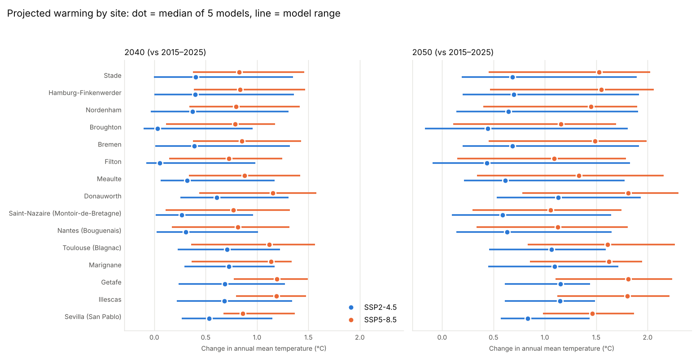
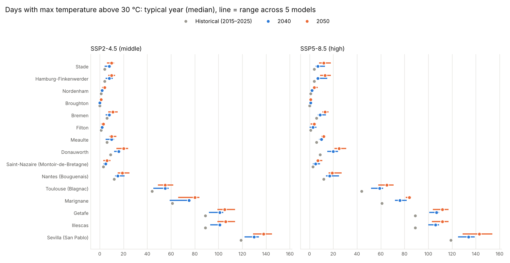
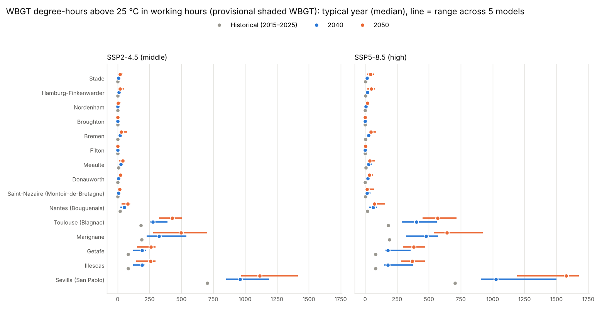

# Phase 2: Future weather files (2040, 2050)

**Status:** complete with **5 of 6 models** (Nov 2026). NorESM2-MM was ~50 % downloaded when the background download hit its 2-hour limit. See "Open item" below.

Re-run with `scripts/fetch_nex.py` (resumable), then `scripts/phase2_future.py`.

## What was produced

| Output | Location | In git |
|---|---|---|
| NEX-GDDP-CMIP6 daily data at each site (7 variables, 2015–2025 + 2031–2060) | `data/raw/nex/` | No (reproducible) |
| Climate change deltas: per site × model × scenario × period × month (quantile deltas for Tmax/Tmin, ratios for humidity, radiation, wind) | `outputs/phase2/deltas.parquet` | Yes |
| Morphed TMYs: per site × model × scenario × period | `data/weather/future/tmy/` | No (148 MB; regenerated in ~6 min) |
| Annual indicators for every morphed year (11 years × 5 models × 2 scenarios × 2 periods × 15 sites) | `outputs/phase2/annual_summary_future.csv` | Yes |
| Ensemble summary: typical (median year) and hot (90th percentile year), each as model median with min–max range, historical included | `outputs/phase2/ensemble_summary.csv` | Yes |
| Morphing consistency checks | `outputs/phase2/morph_checks.csv` | Yes |
| Figures | `docs/phase2/figures/` | Yes |

## Method

- **Climate signal:** NEX-GDDP-CMIP6 v2.0, 0.25°, bias-corrected daily data. Each site uses its own cell.
  - **Models:** ACCESS-CM2, EC-Earth3, CMCC-ESM2, MRI-ESM2-0, MPI-ESM1-2-HR (NorESM2-MM pending).
  - **Scenarios:** SSP2-4.5 and SSP5-8.5.
  - **Windows:** baseline 2015–2025 (matching ERA5), 2040 = 2031–2050, 2050 = 2041–2060.
  - **Access:** server-side subsetting on NASA NCCS THREDDS. The source files store whole global days, so point reads from S3 would cost ~245 MB per variable-year.
- **Morphing:** quantile-based (`src/climate_risk/morph.py`), applied to all 11 ERA5 years and to the TMY.
  - **Temperature:** each day's Tmax and Tmin are shifted by the model change at that day's percentile (5th–95th, held flat beyond), and the hours in between are stretched.
  - **Humidity:** vapour pressure is scaled by the specific-humidity ratio and capped at saturation.
  - **Radiation and wind:** GHI/DNI/DHI, longwave and wind are scaled by monthly ratios.
  - **Smoothing:** all signals are interpolated day by day between mid-month anchors.
- **Indicators:** the same as Phase 1, including the provisional shaded WBGT, which is replaced in Phase 3.

## Checks

- **Morphed years reproduce the model warming:** annual mean change within **0.03 °C** of the model's tas delta for every site/model/scenario/period, and monthly within **0.6 °C** (differences come from quantile vs mean changes, as expected).
- **All morphed records pass the standard validation:** no gaps, RH ≤ 100 %, radiation in range.
- **Tests:** `tests/test_morph.py` covers uniform shifts, hot-day amplification, the humidity cap and the radiation ratio.

## Results

### Warming in annual mean temperature vs 2015–2025 (median of 5 models)

| Site | SSP2-4.5 2040 | SSP2-4.5 2050 | SSP5-8.5 2040 | SSP5-8.5 2050 |
|---|---|---|---|---|
| Sevilla (San Pablo) | +0.5 | +0.8 | +0.9 | +1.5 |
| Illescas | +0.7 | +1.1 | +1.2 | +1.8 |
| Getafe | +0.7 | +1.2 | +1.2 | +1.8 |
| Marignane | +0.7 | +1.1 | +1.1 | +1.6 |
| Toulouse (Blagnac) | +0.7 | +1.1 | +1.1 | +1.6 |
| Nantes (Bouguenais) | +0.3 | +0.6 | +0.8 | +1.1 |
| Saint-Nazaire (Montoir-de-Bretagne) | +0.3 | +0.6 | +0.8 | +1.1 |
| Donauworth | +0.6 | +1.1 | +1.2 | +1.8 |
| Meaulte | +0.3 | +0.6 | +0.9 | +1.3 |
| Filton | +0.1 | +0.4 | +0.7 | +1.1 |
| Bremen | +0.4 | +0.7 | +0.9 | +1.5 |
| Broughton | +0.0 | +0.4 | +0.8 | +1.2 |
| Nordenham | +0.4 | +0.6 | +0.8 | +1.4 |
| Hamburg-Finkenwerder | +0.4 | +0.7 | +0.8 | +1.5 |
| Stade | +0.4 | +0.7 | +0.8 | +1.5 |

These changes are **relative to today's climate (2015–2025)**, not to pre-industrial. In this ensemble, inland Spain, Toulouse, Marignane and Donauwörth warm fastest (about +1.6 to +1.8 °C by 2050 under SSP5-8.5), while the UK and Brittany coasts warm slowest. The model ranges are wide (see figure): one model shows almost no warming at the UK sites under SSP2-4.5 by 2040.

### Heat indicators: typical year (median year); future = model median (range)

| Site | Days > 30 °C: hist | 2050 SSP2-4.5 | 2050 SSP5-8.5 | WBGT degree-h > 25 (work hrs): hist | 2050 SSP2-4.5 | 2050 SSP5-8.5 |
|---|---|---|---|---|---|---|
| Sevilla (San Pablo) | 119 | 138 (129–145) | 143 (129–154) | 704 | 1116 (970–1415) | 1578 (1192–1676) |
| Illescas | 89 | 106 (99–114) | 112 (103–117) | 82 | 259 (147–297) | 368 (282–470) |
| Getafe | 89 | 105 (99–114) | 112 (104–117) | 82 | 262 (151–298) | 382 (295–470) |
| Marignane | 61 | 80 (66–84) | 84 (81–86) | 189 | 497 (278–703) | 642 (539–922) |
| Toulouse (Blagnac) | 44 | 55 (49–62) | 65 (58–71) | 182 | 427 (326–504) | 570 (449–717) |
| Nantes (Bouguenais) | 12 | 19 (15–25) | 19 (16–27) | 19 | 80 (32–100) | 72 (60–156) |
| Saint-Nazaire (Montoir-de-Bretagne) | 3 | 6 (3–9) | 7 (6–11) | 2 | 14 (5–28) | 16 (11–70) |
| Donauworth | 9 | 20 (14–24) | 25 (21–31) | 0 | 21 (10–23) | 33 (22–62) |
| Meaulte | 6 | 10 (8–14) | 12 (10–14) | 6 | 41 (12–54) | 36 (26–79) |
| Filton | 1 | 3 (1–4) | 4 (1–6) | 0 | 1 (0–5) | 1 (0–23) |
| Bremen | 6 | 11 (7–15) | 13 (11–16) | 1 | 28 (20–73) | 45 (29–88) |
| Broughton | 0 | 1 (0–1) | 1 (0–2) | 0 | 0 (0–0) | 0 (0–2) |
| Nordenham | 1 | 4 (2–5) | 4 (3–7) | 0 | 5 (2–24) | 17 (3–23) |
| Hamburg-Finkenwerder | 4 | 10 (7–13) | 13 (9–18) | 2 | 20 (10–52) | 48 (17–78) |
| Stade | 4 | 10 (6–12) | 12 (8–18) | 2 | 18 (9–42) | 42 (14–70) |

## Findings

1. **Heat stress grows much faster than temperature.** Small shifts in mean temperature produce large relative increases in WBGT degree-hours in working hours. In typical years by 2050 under SSP5-8.5: Sevilla +124 %, Toulouse ×3, Marignane ×3.4, Getafe/Illescas ×4–5. Northern sites start from near zero and reach about 20–50 degree-hours.
2. **Days above 30 °C:** Sevilla 119 → ~143, Madrid sites 89 → ~112, Toulouse 44 → ~65, Donauwörth 9 → ~25, northern Germany 4 → ~12–13. The UK sites stay low (≤ 4).
3. **Peak amplification is not uniform.** For summer daily maximum temperature (SSP5-8.5, 2050), the 95th-percentile day warms **~1 °C more than the median day in northern Germany** (Hamburg, Stade, Bremen, Nordenham), ~0.4–0.7 °C more in western France, Toulouse and the UK, and **about the same as the median in Spain**. The quantile-based method captures this site by site. The concept's earlier expectation of stronger peak amplification "especially in Iberia" is not supported by this ensemble.
4. **The extreme tail is noisy.** The 99th percentile rests on ~3 days per month in an 11-year baseline, and models disagreed by more than 4 °C there. Deltas are therefore taken up to the 95th percentile and held constant beyond it.
5. **Shaded WBGT > 28 °C (Class 2) is still rare in 2050** outside Sevilla (~195 h/yr under SSP5-8.5), Toulouse (~64 h) and Marignane (~54 h). This confirms the Phase 1 finding: the outcome for indoor workers will depend mainly on the Phase 3 WBGT method (natural wet bulb, sun vs shade) and on indoor offsets.
6. **Scenario spread before 2050 is modest** compared with the model spread, as expected: emissions pathways diverge mostly after mid-century.

## Open item: NorESM2-MM (6th model)

The download was stopped at the 2-hour background limit with NorESM2-MM about half done (~290 variable-years, ~11 minutes, remaining). NorESM2-MM is the **lowest-sensitivity** model in the set, so without it the ensemble median may lean slightly warm. Resume with `scripts/fetch_nex.py`, then re-run `scripts/phase2_future.py` (all configured models).
